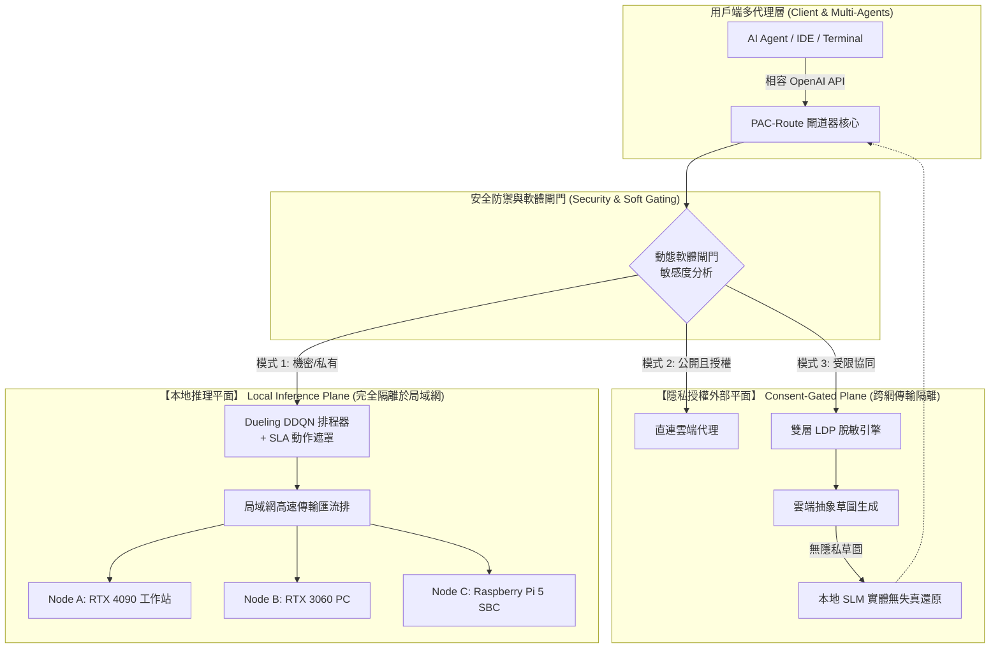

# 第三章 PAC-Route 系統架構與數學建模 (System Design & Formal Modeling)

本章將詳述 PAC-Route 系統之整體拓撲架構、安全隔離平面劃分、局域網動態發現機制，並對推論任務之端到端延遲、SLA 動作遮罩深度強化學習調度模型，以及雙層差分隱私進行嚴格之數學形式化建模。

---

## 3.1 去中心化兩平面隔離架構設計 (Uncentralized Two-Plane Architecture)

PAC-Route 在架構頂層徹底破除傳統將局域網與公有雲扁平混合的作法，提出**去中心化兩平面安全架構**：

### 1. 本地推理平面 (Local Inference Plane)
* **安全邊界**：侷限於實體局域網（Subnet）內部。所有資料封包均透過局域網高速交換器或 WiFi 傳輸。
* **執行準則**：處理標記為機密（TopSecret）之請求，或在未取得使用者顯式外部授權時處理所有本地請求。該平面內的推論節點絕不將原始提示詞轉發至外部公網。

### 2. 隱私授權外部平面 (Consent-Gated Plane)
* **安全邊界**：跨越 NAT 與網際網路，連接至公有雲大型模型（如 GPT-4o、Claude 3.5）。
* **執行準則**：落實「**絕不靜默外洩（Never Silently Leak）**」機制。任何未經授權的外部流量會被直接阻斷；即便獲准卸載至雲端，若包含中度敏感資料，亦必須強制經過雙層差分隱私（2-Layer LDP）實體遮蔽，僅上傳無敏感實體之抽象語義結構。

---

## 3.2 局域網節點自動發現與能力註冊協定

異質個人叢集面臨節點動態開機、離線、休眠或切換任務之常態。PAC-Route 採用零配置（Zero-Config）之 mDNS / DNS-SD 機制，使節點加入時自動廣播其硬體特徵與模型清單：

### 節點能力設定檔 (Node Capability Profile)
每個節點 $N_j$ 在局域網中維護一組能力元組：
$$C(N_j) = \langle \text{Role}_j, \text{GPU}_j, V_{total}, V_{free}, M_{supp}, M_{load}, \mu_j, \text{RTT}_j \rangle$$

* $\text{Role}_j \in \{\text{WorkstationGpu}, \text{EdgeGpu}, \text{EdgeSbc}, \text{CloudProxy}\}$：節點硬體定位；
* $V_{free}$：當前可用顯存或記憶體（MB）；
* $M_{supp}, M_{load}$：支援的模型集合與當前已預先載入顯存之常駐模型集合；
* $\mu_j$：基準解碼吞吐率（Tokens per Second）；
* $\text{RTT}_j$：至閘道核心的網路往返時延。

閘道器維護動態註冊表（Node Registry），透過週期性心跳（預設 5 秒）監控節點活性。若連續 30 秒未收到心跳，該節點自動標記為離線（Offline），即時從候選調度名單中移除。

---

## 3.3 SLA 感知之端到端延遲分解模型

對於抵達系統之推論請求 $R_i = (p_i, D_i, S_i)$，其中 $p_i$ 為提示詞、$D_i$ 為任務 SLA 截止期限（Deadline）、$S_i$ 為隱私等級。若將該請求指派至候選節點 $N_j$，其端到端完成時間 $T_{total}(R_i, N_j)$ 可精確分解為四大核心階段：

$$T_{total}(R_i, N_j) = T_{queue}(N_j) + T_{load}(N_j, m_i) + T_{trans}(R_i, N_j) + T_{exec}(R_i, N_j)$$

### 1. 佇列等待延遲 $T_{queue}$
由節點當前待處理請求數 $Q_j$ 及該節點的平均推論服務速率決定：
$$T_{queue}(N_j) = Q_j \cdot \bar{T}_{service}(N_j)$$

### 2. 模型載入與顯存換入開銷 $T_{load}$
若目標模型 $m_i \in M_{load}(N_j)$，則無載入時間；反之，若需將模型從磁碟換入顯存：
$$T_{load}(N_j, m_i) = \begin{cases} 0, & \text{若 } m_i \in M_{load}(N_j) \\ \frac{\text{Size}(m_i)}{B_{disk/PCIe}(N_j)} + \tau_{init}, & \text{若 } m_i \notin M_{load}(N_j) \end{cases}$$
在個人異質設備中，樹莓派經由 MicroSD 卡換入 3B 模型需耗時數秒，此項預測為防止 SLA 違約之關鍵指標。

### 3. 傳輸延遲 $T_{trans}$
包含局域網傳輸資料時間與往返時延：
$$T_{trans}(R_i, N_j) = \frac{|p_i|}{B_{net}(N_j)} + \text{RTT}_j$$

### 4. 實際推論執行時間 $T_{exec}$
包含提示詞預填充階段（Prefill Phase）與逐 Token 自回歸生成階段（Decoding Phase）：
$$T_{exec}(R_i, N_j) = \alpha_j \cdot \text{Len}_{prompt}(p_i) + \frac{\text{Len}_{gen}(R_i)}{\mu_j}$$
其中 $\alpha_j$ 為 Prefill 每 Token 處理係數，$\text{Len}_{gen}$ 為預期生成 Token 長度。

---

## 3.4 基於動作遮罩之 Dueling DDQN 排程模型

本系統將異質個人叢集的任務排程問題形式化為馬可夫決策過程（Markov Decision Process, MDP）：

### 1. 狀態空間 (State Space $\mathcal{S}$)
狀態向量 $s_t \in \mathcal{S}$ 全面捕捉叢集與即時請求特徵：
$$s_t = \Big[ Q_1, \dots, Q_K, V_{free, 1}, \dots, V_{free, K}, \text{RTT}_1, \dots, \text{RTT}_K, \text{Len}(p_t), D_t, S_t \Big]$$

### 2. 動作空間 (Action Space $\mathcal{A}$)
動作 $a_t \in \mathcal{A} = \{1, 2, \dots, K, K+1\}$ 代表將請求指派至第 $j$ 個本地節點或轉交語義草圖協同管線。

### 3. SLA 動作遮罩矩陣 (Action-Masking Mechanism)
為了防止強化學習在探索階段將請求發送至必將違約的節點，我們定義二元遮罩向量 $M(s_t, a) \in \{0, 1\}$：
$$M(s_t, a) = \begin{cases} 1, & \text{若 } T_{total}(R_t, N_a) \le D_t \quad \text{且} \quad \text{PrivacyCheck}(S_t, N_a) = \text{True} \\ 0, & \text{其他 (強制排除)} \end{cases}$$

被遮蔽動作之輸出 Q 值將直接被置為極小負無窮大：
$$\tilde{Q}(s_t, a) = \begin{cases} Q(s_t, a), & \text{若 } M(s_t, a) = 1 \\ -\infty, & \text{若 } M(s_t, a) = 0 \end{cases}$$

決策時依據遮罩後的分佈選取最佳動作：
$$a_t^* = \arg\max_{a \in \mathcal{A}} \tilde{Q}(s_t, a)$$

### 4. 獎勵函數 (Reward Formulation)
本系統目標為最小化端到端耗時並徹底消除 SLA 違約與隱私洩漏：
$$r_t = - \Big( T_{total}(R_t, N_{a_t}) + \lambda_{sla} \cdot \mathbf{1}_{\{T_{total} > D_t\}} + \lambda_{priv} \cdot \mathbf{1}_{\{\text{PrivacyViolation}\}} \Big)$$

---

## 3.5 雙層本地差分隱私 (2-Layer LDP) 語義草圖協同理論

在協同模式中，輸入提示詞 $p_i$ 包含敏感實體集合 $\mathcal{E} = \{e_1, e_2, \dots, e_m\}$。

### 第一層：隨機化回應 (Randomized Response)
針對離散實體標籤與屬性，採用局部隨機化回應（Local Randomized Response, L-RR），在本地設備進行類別混淆。給定隱私預算 $\epsilon_1$：
$$\mathbb{P}(\tilde{e} = e) = \frac{e^{\epsilon_1}}{e^{\epsilon_1} + |\mathcal{C}| - 1}$$
其中 $|\mathcal{C}|$ 為實體類別總數。

### 第二層：拉普拉斯雜訊擾動 (Laplace Perturbation)
針對數值型特徵或關鍵字統計頻率，注入符合零均值拉普拉斯分佈之雜訊：
$$\tilde{x} = x + \text{Laplace}\left(0, \frac{\Delta f}{\epsilon_2}\right)$$
其中 $\Delta f$ 為查詢敏感度，$\epsilon_2$ 為第二層隱私預算。整體隱私消耗滿足序列合成定理（Sequential Composition Theorem）：$\epsilon_{total} = \epsilon_1 + \epsilon_2$。

### 語義草圖生成與還原定理
**定義（語義草圖 Semantic Sketch）**：雲端模型在接收到去敏抽象提示詞 $p_{sanitized} = \text{Mask}(p_i, \mathcal{E})$ 後，輸出僅包含抽象推理框架之回應 $y_{sketch}$。  
**還原（Lossless Local Reconstruction）**：邊緣節點在完全隔離的記憶體空間中，藉由雙向雜湊映射表 $\mathcal{M}: \text{Placeholder} \to \text{Entity}$，執行無失真置換還原：
$$y_{final} = \text{Unmask}(y_{sketch}, \mathcal{M})$$
此機制在數學上保證了任何實體私鑰、真實姓名、IP 與機密數值「**零資訊量流入外部公網**」（即互資訊量 $I(X_{private}; Y_{cloud}) = 0$）。
